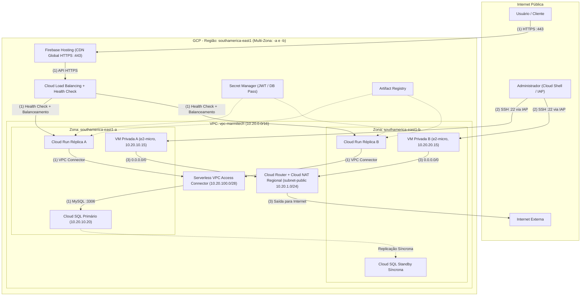

# Proposta de Alta Disponibilidade Projetada (Parte C)

> **Importante:** Conforme diretriz da Entrega 2, esta arquitetura de Alta Disponibilidade (HA) é **apenas projetada** (diagramada e orçada) e **não deve ser implantada na nuvem**, evitando custos adicionais de Cloud SQL Regional HA, Load Balancer e múltiplas réplicas ativas.

A versão original da Entrega 1 ([`docs/diagramas/PROJETO INTEGRADOR.png`](diagramas/PROJETO%20INTEGRADOR.png)) permanece preservada no repositório para comparação com a versão evoluída ([`docs/diagramas/PROJETO INTEGRADOR HA.vsdx`](diagramas/PROJETO%20INTEGRADOR%20HA.vsdx) e [`docs/diagramas/PROJETO INTEGRADOR HA.png`](diagramas/PROJETO%20INTEGRADOR%20HA.png)).

---

## 1. Requisitos Atendidos (H1 a H7)

### H1 — Distribuição em Duas Zonas e Plano de Endereçamento Atualizado

Todos os recursos computacionais e de rede da VPC `vpc-marmitech` (`10.20.0.0/16`) passam a ser distribuídos em **duas zonas de disponibilidade** dentro da mesma região (`southamerica-east1-a` e `southamerica-east1-b`, em São Paulo). Na GCP, as sub-redes têm escopo regional, mas organizamos faixas dedicadas para isolar o tráfego das cargas zonais e do conector serverless:

| Recurso | Nome | Bloco CIDR | Escopo / Zona | Finalidade |
| :--- | :--- | :--- | :--- | :--- |
| **Rede Virtual** | `vpc-marmitech` | `10.20.0.0/16` | Global | VPC principal do projeto |
| **Sub-rede Pública** | `subnet-public` | `10.20.1.0/24` | Regional (`-a` e `-b`) | Suporte ao Cloud Router / Cloud NAT regional |
| **Sub-rede Privada (Zona A)** | `subnet-private-a` | `10.20.10.0/24` | Regional (alocação zona `southamerica-east1-a`) | VM Privada A (`10.20.10.15`) e instância primária do Cloud SQL |
| **Sub-rede Privada (Zona B)** | `subnet-private-b` | `10.20.20.0/24` | Regional (alocação zona `southamerica-east1-b`) | VM Privada B (`10.20.20.15`) e standby do Cloud SQL |
| **Conector VPC Serverless** | `subnet-vpc-connector` | `10.20.100.0/28` | Regional (`-a` e `-b`) | Conexão privada do Cloud Run multi-zona com a VPC |

### H2 — Balanceamento de Carga e Health Check

- Um **Global External Application Load Balancer (Cloud Load Balancing)** recebe as requisições HTTPS (`:443`) dos usuários finais (ou via Firebase Hosting / CDN) e distribui o tráfego entre **no mínimo 2 réplicas/instâncias ativas** do backend **Cloud Run (`marmitech-api`)** distribuídas automaticamente entre `southamerica-east1-a` e `southamerica-east1-b` (`min_instance_count = 2`).
- **Health Check:** O balanceador e o runtime do Cloud Run executam sondas HTTP periódicas (`startup_probe` e `liveness_probe` no endpoint `/actuator/health` ou `/api/health` na porta `8080`, intervalo de `10s`, timeout `3s`, limiar de falha `3`), removendo automaticamente instâncias não saudáveis da rotação de tráfego.

### H3 — Estratégia de NAT Explícita

- Na GCP, o **Cloud NAT é um recurso gerenciado regional** (associado a um Cloud Router na região `southamerica-east1`), atendendo simultaneamente às sub-redes privadas nas zonas `-a` e `-b`.
- **Escolha adotada:** **Cloud NAT regional compartilhado** (com múltiplos IPs estáticos ou alocação automática em produção, conforme necessidade de portas) em vez de criar uma VM com `iptables` por zona.
- **Consequência da escolha:** Reduz a complexidade operacional e evita manter instâncias de NAT manualmente em cada zona; em contrapartida, todas as zonas compartilham o mesmo gateway lógico e o plano de controle regional da GCP em `southamerica-east1`, exigindo dimensionamento adequado de portas/IPs por VM caso o volume de conexões de saída cresça.

### H4 — Estratégia para o Banco de Dados

- Evolução do Cloud SQL (`MYSQL_8_0`) para configuração **Regional (High Availability)** (`availability_type = "REGIONAL"`):
  - **Instância Primária:** alocada em `southamerica-east1-a`.
  - **Réplica Standby Síncrona:** alocada em `southamerica-east1-b`, recebendo replicação síncrona em disco regional gerenciado.
- Em caso de falha na zona `-a` ou na instância primária, o Cloud SQL executa **failover automático** para a zona `-b` mantendo o mesmo endereço IP privado interno (reduzindo intervenção manual).
- *(Nota: conforme ADR-005 e Entrega 2, a HA do banco protege contra falha de zona/hardware, mas **não substitui backup** contra exclusão acidental de tabelas ou corrupção lógica.)*

### H5 — Estado da Aplicação Fora da Instância

- **Autenticação e Sessão:** A API Spring Boot opera de forma totalmente **stateless** utilizando tokens **JWT** assinados com a chave `JWT_SECRET` armazenada no **Secret Manager**. Nenhuma sessão de usuário é mantida na memória local das réplicas.
- **Dados e Arquivos:** Todos os dados transacionais e cadastrais ficam centralizados no **Cloud SQL Regional (HA)**; eventuais arquivos ou ativos estáticos permanecem fora das instâncias (Firebase Hosting / Cloud Storage), permitindo que qualquer réplica atenda qualquer requisição sem afinidade de sessão (*sticky sessions*).

### H6 — Tratamento dos Pontos Únicos de Falha da Entrega 1 (Seção 5.10)

| Ponto Único de Falha (Entrega 1) | Status na Proposta HA | Tratamento / Justificativa |
| :--- | :--- | :--- |
| **1. Recursos em zona única (`southamerica-east1-a`)** | **Eliminado** | Distribuição em duas zonas (`southamerica-east1-a` e `southamerica-east1-b`) com Load Balancer + Cloud Run multi-zona (`min_instances = 2`) e VMs em zonas distintas. |
| **2. Banco Cloud SQL sem réplica nem failover** | **Eliminado** | Adoção do **Cloud SQL Regional (HA)** com réplica *standby* síncrona na zona `-b` e failover automático gerenciado. |
| **3. Dependência do Console GCP / IAP para acesso administrativo** | **Aceito com justificativa** | O acesso administrativo continua utilizando Cloud Shell + IAP (ADR-001) por ser o canal seguro sem expor portas SSH à internet (`0.0.0.0/0`). O risco residual de indisponibilidade temporária do plano de controle IAM/IAP é aceito por não impactar o tráfego dos usuários finais na aplicação. |

### H7 — Os 3 Fluxos Numerados Redesenhados na Arquitetura HA

1. **Fluxo (1) — Usuário final acessando a aplicação:** O usuário acessa o Firebase Hosting (`HTTPS :443`), que encaminha as chamadas de API ao **Cloud Load Balancing**. O balanceador verifica os *health checks* e distribui as requisições entre as réplicas stateless do **Cloud Run** nas zonas `-a` e `-b`, que acessam o **Cloud SQL Primário** via VPC Connector (`10.20.100.0/28`), com replicação síncrona contínua para a **Standby** na zona `-b`.
2. **Fluxo (2) — Administrador acessando via SSH:** O administrador autentica-se via IAM / Cloud Shell e estabelece túnel **IAP (`35.235.240.0/20`)** para a VM privada na zona `-a` ou na zona `-b` na porta `22`, garantindo redundância administrativa caso uma das zonas esteja indisponível.
3. **Fluxo (3) — Instâncias privadas acessando a internet pelo NAT:** Ambas as sub-redes privadas (`-a` e `-b`) roteiam o tráfego de saída (`0.0.0.0/0`) pelo **Cloud NAT regional compartilhado**, saindo com IP público gerenciado sem expor IPs públicos nas VMs.

---

## 2. Análise de Custo Comparativa (Entrega 1 vs. Proposta HA)

- **Link da calculadora oficial (Proposta HA):** [Google Cloud Pricing Calculator — Proposta HA](https://cloud.google.com/products/calculator?dl=CjhDaVF3WlRjeFlqYzRaUzFtTkdWakxUUXlNVGd0WW1Vd1ppMHpOVGc1T0RNM09ERXhZalFRQVE9PRA0GiQ4RDI1MDAzNy1GMjY4LTQyNUUtODY0QS1EN0ExOEYxMUM3REU)
- **Arquivo exportado:** `docs/custos/estimativa-ha.pdf`

### Comparativo Mensal (Operação Contínua — 730h/mês)

| Versão | Custo Mensal Estimado | Variação (%) |
| :--- | :---: | :---: |
| **Arquitetura Implantada (Entrega 1 — Cenário A)** | **R$ 170,74 / mês** | — |
| **Proposta de Alta Disponibilidade (Entrega 2 — HA)** | **R$ 423,43 / mês** | **+ 148,0%** |

*(Detalhamento da simulação HA: Cloud SQL Regional HA `R$ 250,33`, 2x Compute Engine `e2-micro` `R$ 125,77`, Cloud NAT `R$ 28,78`, Backup and DR for Cloud SQL `R$ 10,55`, 2x Cloud Run `R$ 5,24`, Artifact Registry `R$ 2,75` e Secret Manager `R$ 0,00`.)*

### Itens que Mais Contribuem para o Aumento

1. **Cloud SQL Regional (HA):** A habilitação de alta disponibilidade regional com réplica *standby* síncrona em outra zona praticamente **dobra** o custo computacional e de armazenamento da instância de banco gerenciada.
2. **Cloud Load Balancing (External HTTP/S):** Introduz custo fixo mensal por regras de encaminhamento (*forwarding rules*) e cobrança por volume de tráfego processado (que não existia na Entrega 1).
3. **Instâncias Ativas Mínimas (Cloud Run `min_instances = 2` e segunda VM `e2-micro`):** Manter réplicas quentes em duas zonas remove a escala a zero no Cloud Run e duplica o custo mensal de Compute Engine.

### O Custo se Justifica para o Perfil da Marmitech?

**Não, para o estágio atual da Marmitech.** Conforme a Seção 5.1 da Entrega 1, a aplicação atende cerca de **50 usuários simultâneos** (~1.000 requisições/dia) em **horário comercial**, com disponibilidade esperada de **99,5%**. Nesse perfil de carga, o aumento expressivo do custo fixo mensal com Cloud SQL Regional HA, Load Balancer e réplicas sempre ligadas é desproporcional ao impacto financeiro de uma eventual janela curta de indisponibilidade. A arquitetura HA projetada só passaria a se justificar caso o sistema evoluísse para operação crítica 24/7 com SLA igual ou superior a 99,95% e múltiplos restaurantes simultâneos.
