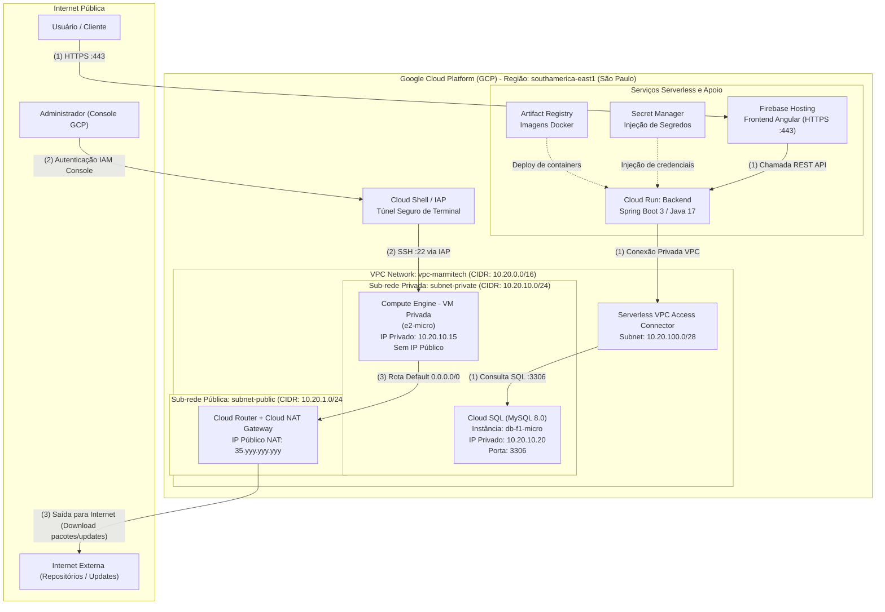

# Projeto de Arquitetura e Decisões de Infraestrutura em Nuvem

**Entrega 1 - Projeto Integrador**  
**Instituição:** Uniamérica Descomplica  
**Professor:** Gildomiro Bairros  
**Aplicação:** Marmitech - Sistema de Gerenciamento de Pedidos
**Provedor de Nuvem Escolhido:** Google Cloud Platform (GCP)  
**Região Principal:** `southamerica-east1` (São Paulo, Brasil)

---

## 5.1 Descrição da Aplicação

### Problema que a Aplicação Resolve

A **Marmitech** é uma solução voltada a restaurantes e marmitarias que necessitam automatizar o processo de recebimento de pedidos via cardápio digital e organizar o fluxo da cozinha por meio de uma fila de atendimento em tempo real. O sistema elimina gargalos em anotações manuais e integra o registro do cliente, seleção de marmitas/itens adicionais e controle operacional de status (Pendente, Em Preparação, Concluído).

### Usuários e Perfis de Acesso

1. **Clientes Finais / Funcionários Solicitantes:** Acessam a interface web pública para navegar pelo cardápio, montar marmitas e registrar pedidos.
2. **Operadores de Cozinha e Gerência:** Visualizam o painel de pedidos e a fila de preparo, alterando os status das entregas.
3. **Administradores de Infraestrutura (Equipe do Projeto):** Acessam o ambiente via terminal SSH seguro intermediado pelo console GCP (Cloud Shell / Identity-Aware Proxy) para manutenção, inspeção de logs e diagnósticos de conectividade.

### Principais Funcionalidades

- Cadastro e listagem de clientes.
- Gerenciamento de cardápio e itens com preços e descrições.
- Registro transacional de pedidos contendo múltiplos itens.
- Fila de atendimento automatizada com ordenação por status.
- Histórico de pedidos e persistência relacional.

### Componentes Técnicos

- **Frontend Web:** Aplicação SPA em Angular distribuída e hospedada via **Firebase Hosting**, garantindo baixa latência via CDN global e certificado SSL/HTTPS nativo.
- **Backend API:** Aplicação Java 17 com **Spring Boot 3**, Spring Data JPA e Maven, executando sob **Google Cloud Run** em ambiente serverless com conexão privada à VPC.
- **Banco de Dados:** Banco de dados relacional **MySQL 8.0** hospedado no serviço totalmente gerenciado **Google Cloud SQL**, isolado na sub-rede privada da VPC sem endereço IP público.
- **Instância Privada Computacional (Worker / Testes):** Máquina virtual Linux (Ubuntu 22.04 LTS) em instância Compute Engine `e2-micro`, localizada na sub-rede privada sem IP público, utilizada para rotinas operacionais, diagnósticos internos e validação de saída à internet via NAT.
- **Acesso Administrativo (Cloud Shell / IAP):** Túnel SSH autenticado diretamente pelo terminal do Google Cloud via Identity-Aware Proxy (IAP), sem necessidade de exposição de portas nem alocação de Bastion Host com IP público.

### Requisitos Não-Funcionais Assumidos

- **Carga Prevista:** Sistema dimensionado para suportar até 50 usuários simultâneos e ~1.000 requisições diárias (aproximadamente 30.000 a 35.000 requisições/mês).
- **Disponibilidade Esperada:** Operação em horário comercial com disponibilidade estimada em 99,5%.
- **Declaração de Alta Disponibilidade:** A arquitetura desta Entrega 1 **NÃO oferece alta disponibilidade (Multi-AZ)**. Os recursos da VPC e o banco de dados estão alocados em uma única zona de disponibilidade (`southamerica-east1-a`), priorizando a contenção de custos de infraestrutura no período inicial. A proposta completa de alta disponibilidade (com distribuição multi-zonas e failover gerenciado) é documentada como evolução projetada para a Entrega 2.

---

## 5.2 Diagrama de Arquitetura

### Três Fluxos de Rede Obrigatórios

1. **Fluxo (1) - Usuário final acessando a aplicação:** O usuário acessa a URL pública HTTPS do Firebase Hosting (`:443`). O Firebase encaminha as requisições de API para o Cloud Run Backend. Por meio do Serverless VPC Access Connector (`10.20.100.0/28`), o backend transita para dentro da VPC privada e executa operações no banco Cloud SQL for MySQL na porta `3306`, sem exposição pública do banco.
2. **Fluxo (2) - Administrador acessando via SSH:** O administrador se autentica no console da Google Cloud via Cloud Shell / Identity-Aware Proxy (IAP) e abre túnel SSH (`:22`) diretamente para a VM Privada na sub-rede privada. Não há portas SSH expostas para a internet nem necessidade de IP público no host.
3. **Fluxo (3) - Instância privada acessando a internet pelo NAT:** A VM privada, isolada sem IP público, dispara conexões de saída (para atualização de pacotes ou downloads). A rota padrão (`0.0.0.0/0`) encaminha o pacote para o Cloud Router e Cloud NAT Gateway na sub-rede pública, que realiza o mascaramento do endereço com IP público do NAT e conclui a comunicação na internet externa.

---

## 5.3 Plano de Endereçamento IP

### Particularidade do Modelo GCP

Na Google Cloud Platform, a Virtual Private Cloud (VPC) possui escopo **global**, enquanto as sub-redes possuem escopo **regional**. Na GCP, a segmentação pública e privada é estabelecida da seguinte forma:

- **Sub-rede Pública:** Aloja componentes como o Cloud NAT Gateway e serviços com interface para a internet.
- **Sub-rede Privada:** Aloja instâncias e o banco de dados que possuem estritamente IPs internos (RFC 1918) e não recebem IPs públicos diretos, alcançando a internet exclusivamente por tradução de saída via Cloud NAT.

O provedor reserva por padrão os **2 primeiros e os 2 últimos endereços** de qualquer bloco de sub-rede para fins de infraestrutura de rede interna da GCP.

### Tabela de Endereçamento

| Recurso | Nome | Bloco CIDR | Zona | Tipo | Finalidade |
| :--- | :--- | :--- | :--- | :--- | :--- |
| **Rede Virtual** | `vpc-marmitech` | `10.20.0.0/16` | Global | Custom VPC | Rede principal do projeto (65.536 IPs teóricos). |
| **Sub-rede Pública** | `subnet-public` | `10.20.1.0/24` | `southamerica-east1` | Pública | Alocação do Cloud Router e Cloud NAT Gateway. |
| **Sub-rede Privada** | `subnet-private` | `10.20.10.0/24` | `southamerica-east1` | Privada | Hospedagem da VM privada e endereço privado do Cloud SQL (254 IPs úteis). |
| **Conector Serverless** | `subnet-vpc-connector` | `10.20.100.0/28` | `southamerica-east1` | Conector VPC | Faixa dedicada de rede exigida pelo Serverless VPC Access Connector. |

---

## 5.4 Tabelas de Rota

A VPC opera em modo customizado com roteamento padrão gerenciado da Google Cloud:

| Sub-rede | Destino | Alvo / Next Hop | Descrição / Finalidade |
| :--- | :--- | :--- | :--- |
| **Todas as Sub-redes** | `10.20.0.0/16` | Local / VPC | Roteamento interno direto entre componentes da mesma VPC. |
| **Sub-rede Pública** | `0.0.0.0/0` | Default Internet Gateway | Ponto de saída do Cloud NAT Gateway para a internet. |
| **Sub-rede Privada** | `0.0.0.0/0` | Cloud NAT (via Cloud Router) | Permite que instâncias sem IP público iniciem conexões de saída para a internet. |

> **Explicação obrigatória:** Se a rota `0.0.0.0/0 → Cloud NAT` não existisse na sub-rede privada, a instância privada ficaria totalmente incomunicável com o mundo exterior. Ela seria incapaz de baixar atualizações do sistema operacional (`apt-get update`), instalar pacotes necessários ou executar testes de saída de rede (`curl ifconfig.me`).

---

## 5.5 Matriz de Regras de Segurança (Firewall Rules)

Na GCP, as regras de firewall de instância são aplicadas em nível de interface de rede da VPC utilizando **Network Tags**:

| Nome da Regra | Direção | Protocolo | Porta | Origem | Destino (Target Tag) | Justificativa |
| :--- | :--- | :--- | :--- | :--- | :--- | :--- |
| `fw-allow-ssh-iap` | Entrada (Ingress) | TCP | 22 | Faixa IAP da GCP (`35.235.240.0/20`) | `fw-private` | Permite túnel SSH autenticado via Cloud Shell / Identity-Aware Proxy. SSH nunca liberado para `0.0.0.0/0`. |
| `fw-allow-mysql-internal` | Entrada (Ingress) | TCP | 3306 | Sub-redes da VPC (`10.20.0.0/16`) | Cloud SQL | Conexão ao banco de dados MySQL liberada apenas para o conector VPC do Cloud Run e VM de testes. |
| `fw-allow-egress-default` | Saída (Egress) | TCP/UDP | 80, 443, 53 | Instâncias internas | `0.0.0.0/0` (via NAT) | Saída autorizada apenas para tráfego web HTTP/HTTPS e resolução DNS para atualização de pacotes. |

---

## 5.6 Tecnologias

| Camada | Tecnologia | Versão | Justificativa |
| :--- | :--- | :--- | :--- |
| **Provedor e Região** | Google Cloud Platform (GCP) | - | Região `southamerica-east1` (São Paulo, Brasil). Justificada pela menor latência para usuários locais e disponibilidade de créditos. |
| **Hospedagem Frontend** | Firebase Hosting | - | Plataforma global gerenciada com CDN e SSL automático para entrega rápida dos arquivos estáticos Angular. |
| **Runtime / Backend** | Cloud Run (Java / Spring Boot 3) | Java 17 | Container serverless com escalabilidade sob demanda até zero, alta eficiência e custo reduzido. |
| **Sistema Operacional (VM)** | Ubuntu Server LTS | 22.04 LTS | Sistema operacional da VM privada para diagnósticos e testes de saída via NAT. |
| **Banco de Dados** | MySQL (Cloud SQL) | 8.0 | Serviço gerenciado com backups automatizados e isolamento privado de rede. |
| **Gerenciamento de Segredos** | Google Secret Manager | - | Guarda senhas de banco e credenciais fora do repositório de código. |

---

## 5.7 Dimensionamento das Instâncias

| Componente | Família | Tipo | vCPU | Memória | Disco (Tipo e Tamanho) | Sub-rede | Justificativa |
| :--- | :--- | :--- | :--- | :--- | :--- | :--- | :--- |
| **Instância Privada** | Família E2 (CPU compartilhada) | `e2-micro` | 0.25 vCPU (2 threads) | 1.0 GB RAM | Standard Persistent Disk (10 GB) | `subnet-private` | Instância auxiliar para testes de conectividade interna, consultas locais e validação de saída via NAT. |
| **Banco de Dados** | Cloud SQL Enterprise | `db-f1-micro` | 1 vCPU compartilhada | 3.75 GB RAM | HDD Standard (10 GB) | `subnet-private` | Adequado para suportar o volume de testes do cardápio e persistência sem desperdício de recursos. |
| **Backend API** | Cloud Run Serverless | Serverless Service | 1 vCPU dedicada sob demanda | 512 MB - 1 GB RAM | Efêmero | Serverless VPC | Execução sob demanda escalável até zero quando inativa, otimizando drasticamente os custos operacionais. |
| **Frontend Web** | Firebase Hosting | CDN Global | - | - | Estático | Borda Global | Hospedagem estática com cache em borda e tráfego gratuito na camada básica. |

> **Comportamento sob limite de CPU compartilhada:** A família `E2` utiliza CPU baseada em cotas compartilhadas inteligentes do Google. Se a máquina computacional atingir pico de consumo sustentado que exceda sua fração contratada, o hypervisor realiza *throttling* da CPU (reduzindo a frequência de processamento até que o ciclo se normalize). Como a VM privada executa apenas sessões de terminal interativo e comandos pontuais, esse throttling não afeta a estabilidade nem causa interrupção de serviço.

---

## 5.9 Estimativa de Custos

A estimativa foi desenvolvida utilizando a calculadora oficial da Google Cloud Platform (**Google Cloud Pricing Calculator**).

- **Link oficial compartilhável (Cenário B - 25h de trabalho):**  
  [https://cloud.google.com/products/calculator?dl=CjhDaVJtWTJJNVkySXpOUzB3TldRM0xUUm1PREl0WVRaaFpDMDJPR0l3TmpKbE5tTmlZVFVRQVE9PRAIGiRCQTZFMkExQS1FMDgwLTQ2MUUtQjRDQS02RDA4QzE3OUI3Rjk](https://cloud.google.com/products/calculator?dl=CjhDaVJtWTJJNVkySXpOUzB3TldRM0xUUm1PREl0WVRaaFpDMDJPR0l3TmpKbE5tTmlZVFVRQVE9PRAIGiRCQTZFMkExQS1FMDgwLTQ2MUUtQjRDQS02RDA4QzE3OUI3Rjk)
- **Link oficial compartilhável (Cenário A - 730h mensais contínuas):**  
  [https://cloud.google.com/products/calculator?dl=CjhDaVJoT0RnMlpUbGhZaTAzWVRGbExUUmlNemd0T0dNMVlpMHlOell3TXpJNU9HRTJZVGNRQVE9PRAIGiRCQTZFMkExQS1FMDgwLTQ2MUUtQjRDQS02RDA4QzE3OUI3Rjk](https://cloud.google.com/products/calculator?dl=CjhDaVJoT0RnMlpUbGhZaTAzWVRGbExUUmlNemd0T0dNMVlpMHlOell3TXpJNU9HRTJZVGNRQVE9PRAIGiRCQTZFMkExQS1FMDgwLTQ2MUUtQjRDQS02RDA4QzE3OUI3Rjk)
- **Planilha exportada:** Disponível em [`docs/custos/estimativa.csv`](docs/custos/estimativa.csv).

### Comparativo entre Cenários Obrigatórios

| Serviço / Componente | Dimensionamento Detalhado | Cenário A: Operação Contínua (730h/mês) | Cenário B: Trabalho/Testes (25h) |
| :--- | :--- | :--- | :--- |
| **Firebase Hosting** | Frontend Web Angular SPA (Plano Spark - Free) | R$ 0,00 | R$ 0,00 |
| **Compute Engine (VM Privada)** | `e2-micro`, 10 GB Persistent Disk Standard | R$ 60,50 | R$ 5,47 |
| **Cloud Run (Marmitech API)** | 1 vCPU, 512 MiB, Private Backend Service | R$ 2,52 | R$ 0,42 |
| **Cloud SQL for MySQL** | `db-f1-micro`, 10 GB HDD Storage | R$ 75,63 | R$ 2,59 |
| **Cloud NAT Gateway** | 1 Gateway Ativo + 1 GiB tráfego processado | R$ 27,69 | R$ 27,69 |
| **Artifact Registry** | Armazenamento de imagens de container (5 GB) | R$ 2,64 | R$ 2,64 |
| **Secret Manager** | Armazenamento de segredos e rotação (Free Tier) | R$ 0,00 | R$ 0,00 |
| **TOTAL ESTIMADO** | | **R$ 170,74 / mês** | **R$ 39,21** |

*(Nota: Pequenas variações de centavos entre simulações decorrem da atualização da cotação cambial oficial USD/BRL aplicada dinamicamente pela calculadora da Google Cloud).*

### Análise e Perguntas Obrigatórias

1. **Item de custo mais caro:**
   - No **Cenário A**, o item mais caro é o banco de dados gerenciado **Cloud SQL for MySQL (R$ 75,63/mês)**, seguido da instância Compute Engine (R$ 60,50/mês).
   - No **Cenário B**, o serviço de rede **Cloud NAT Gateway (R$ 27,69)** representa a maior fatia dos custos (~71% do total), decorrente da taxa fixa de uptime do gateway.
2. **Forma de reduzi-lo e trade-off (o que se perde):**
   - O Cloud SQL poderia ser substituído pela instalação manual do MySQL em uma máquina virtual Compute Engine `e2-micro`. **O que se perde:** Perde-se a gestão automatizada de patches pelo Google, a simplicidade de rotinas de snapshot/backup integradas e a separação clara de responsabilidades de infraestrutura.
   - O Cloud NAT poderia ser substituído por uma instância Linux de baixo custo com `iptables`. **O que se perde:** Perde-se a alta disponibilidade nativa gerenciada pelo Google, a manutenção transparente e a escalabilidade de vazão de rede.
3. **Nível Gratuito (Free Tier) e Créditos:**
   - A equipe possui **R$ 1.500,00 em créditos ativos de Google Cloud**, garantindo que o valor real despendido no Cenário B será totalmente absorvido sem desembolso financeiro pessoal.
   - **Firebase Hosting (Custo R$ 0,00):** Operando no plano Spark (camada gratuita perpétua do Google/Firebase), que fornece 10 GB de armazenamento e 360 MB/dia de transferência de dados (mais de 10 GB/mês), além de certificados SSL gerenciados sem custo adicional para a entrega do frontend estático em Angular.
   - O Secret Manager é 100% coberto pelo free tier da GCP (até 6 versões de segredos ativas gratuitas com custo R$ 0,00) e as requisições de teste do Cloud Run geram custo de R$ 0,42.
4. **Plano de Controle de Custos:**
   - **Alertas de Orçamento:** Configuração de alerta no *GCP Billing Budgets & Alerts* no valor de R$200,00, com alertas por e-mail quando o consumo atingir 50%, 80% e 100%.
   - **Aplicação de Labels (Tags):** Tags padronizadas em todos os recursos (`ambiente: production`, `ambiente: dev`.
   - **Estratégia de Recriação do Ambiente (Trade-off Custo x Esforço):** Como toda a infraestrutura base será declarada em Terraform na Entrega 2 e o deploy dos containers é automatizado, o grupo adotará a estratégia de destruir os recursos de cobrança por hora (`Cloud NAT` e `Cloud SQL`) ao final de cada dia de validação.

---

## 5.10 Riscos e Limitações Conhecidas da Arquitetura

1. **Ponto Único de Falha na Zona de Disponibilidade (Single Zone):**
   - *Descrição:* Todos os recursos computacionais da VPC (`VM Privada`, `Cloud SQL`) estão alocados em uma única zona física (`southamerica-east1-a`).
   - *Impacto:* Se ocorrer uma falha elétrica, de refrigeração ou de rede no datacenter dessa zona específica da GCP, a aplicação e o banco ficarão indisponíveis.
2. **Ausência de Réplica e Failover do Banco de Dados:**
   - *Descrição:* A instância Cloud SQL foi dimensionada sem redundância (Single Zone / sem High Availability).
   - *Impacto:* Caso ocorra corrupção do disco virtual ou falha interna do MySQL, o Recovery Time Objective (RTO) será elevado, dependendo de restauração manual.
3. **Dependência Exclusiva do Console GCP para Acesso Administrativo:**
   - *Descrição:* O acesso administrativo foi desenhado via Cloud Shell / Identity-Aware Proxy (IAP), sem rota alternativa de SSH direto por IP público.
   - *Impacto:* Se houver indisponibilidade nas APIs do Google Cloud Console ou nos serviços de autenticação IAM, a equipe não conseguirá acessar a VM privada via terminal até que o serviço de console da GCP seja restabelecido.
